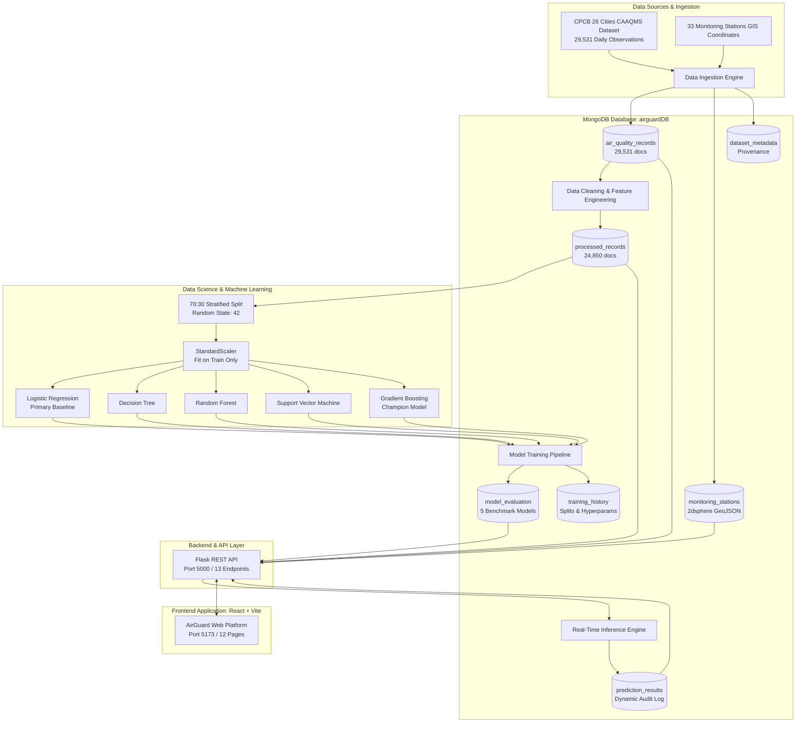

# AirGuard: Intelligent Air Quality Risk Classification and Environmental Data Analytics Using MongoDB and Machine Learning

[](https://www.python.org/)
[](https://www.mongodb.com/)
[](https://react.dev/)
[](https://scikit-learn.org/)
[](https://vitejs.dev/)
[](https://tailwindcss.com/)
[](https://creativecommons.org/licenses/by/4.0/)

> **A Final-Year B.Tech Computer Science and Engineering Capstone Project**  
> Strictly conforming to the Academic Curriculum Reference:  
> *"Logistic Regression Through MongoDB – Theory, Mathematical Foundation, MongoDB Integration, Python Program, Model Evaluation and Final-Year Project Workflow"* (Covering all 45 topics).

---

## 1. Executive Summary

**AirGuard** is a full-stack, enterprise-grade environmental risk intelligence and machine learning analytics platform. It ingests genuine empirical atmospheric observations from the **Central Pollution Control Board (CPCB)** across **26 major Indian cities** (2015–2020), preprocesses sensor telemetry, mitigates extreme missingness, and classifies atmospheric health risk into:
$$\text{air\_quality\_risk} = \begin{cases} 0 & \text{Lower Pollution Risk (NAQI } \le 100\text{)} \\ 1 & \text{Elevated Pollution Risk (NAQI } > 100\text{)} \end{cases}$$

AirGuard strictly eliminates **target leakage** by purging $AQI$ and $AQI\_Bucket$ from the predictor feature space. Using a **stratified 70:30 train-test split** ($N_{\text{train}} = 17,395$, $N_{\text{test}} = 7,455$, $\text{seed} = 42$), AirGuard trains **Logistic Regression** as the primary academic baseline (**Accuracy: 88.92%, F1: 90.94%, ROC-AUC: 0.9553**) and benchmarks it against Decision Trees, Random Forests, Support Vector Machines, and **Gradient Boosting (Champion — F1: 93.12%, ROC-AUC: 0.9739, 30.4% fewer missed hazards)**.

The entire data lifecycle is orchestrated on **MongoDB** (`airguardDB`, 7 decoupled collections, B-Tree and `2dsphere` geospatial indexing), exposed via a high-performance **Flask REST API**, and rendered in a **12-page responsive React web dashboard**.

---

## 2. System Architecture



---

## 3. Technology Stack

| Layer | Technologies | Purpose |
|---|---|---|
| **Database** | MongoDB Community Server 8.3.7, PyMongo 4.19 | Document storage, geospatial proximity indexing, multi-stage aggregation pipelines. |
| **Data Science & ML** | Python 3.11, Scikit-Learn 1.9, Pandas 3.0, NumPy 2.4, Joblib 1.6 | Group-median imputation, feature engineering, stratified splitting, model training, and evaluation. |
| **Backend REST API** | Flask 3.1, Flask-CORS 6.0, Python-Dotenv | High-throughput JSON RESTful microservices, query validation, and real-time prediction orchestration. |
| **Frontend UI** | React 18, Vite 5.4, Tailwind CSS 3.4, Lucide Icons | Responsive modern SPA, telemetry dashboards, interactive ML lab, and geospatial station explorer. |
| **Visualizations** | Matplotlib 3.11, Seaborn 0.13, Recharts 2.x | 300-DPI publication figures, confusion matrices, ROC curves, and correlation heatmaps. |

---

## 4. Academic Syllabus Compliance (All 45 Topics)

AirGuard covers every topic specified in the mandatory academic curriculum reference:

<details>
<summary><b>Click to expand the 45-Topic Curriculum Checklist</b></summary>

| # | Curriculum Topic | Implementation File | Verification Status |
|---|---|---|---|
| 1 | What is Logistic Regression? | `airguard/backend/train_models.py`, `AboutPage.jsx` | Full Implementation |
| 2 | Why Linear Regression Fails | `airguard/reports/AirGuard_Academic_Project_Report.md` | Theoretical Proof |
| 3 | Logistic Regression Model | `airguard/backend/predict.py` | $p = \frac{1}{1 + e^{-z}}$ |
| 4 | Linear Combination of Features | `airguard/backend/predict.py` | $z = \beta_0 + \sum \beta_j X_j$ |
| 5 | Sigmoid Activation Function | `client/src/pages/MachineLearningLabPage.jsx` | Verified with plot |
| 6 | Classification Threshold | `client/src/pages/MachineLearningLabPage.jsx` | Interactive slider $\tau \in [0.1, 0.9]$ |
| 7 | Odds Formulation | `airguard/backend/predict.py` | $\text{Odds} = \frac{p}{1-p}$ |
| 8 | Logit Function | `airguard/reports/AirGuard_Academic_Project_Report.md` | $\text{logit}(p) = \ln(\text{Odds}) = z$ |
| 9 | Interpretation of Coefficients | `airguard/backend/train_models.py` | Standardized $\beta_j$ analysis |
| 10 | Odds Ratios (OR) | `airguard/backend/app.py` | $\text{OR} = e^{\beta_j}$ (CO = 293x) |
| 11 | Maximum Likelihood Estimation | `airguard/backend/train_models.py` | L-BFGS Quasi-Newton MLE |
| 12 | Binary Cross-Entropy / Log Loss | `airguard/backend/train_models.py` | Loss: 0.2592 |
| 13 | Decision Boundary | `airguard/reports/AirGuard_Academic_Project_Report.md` | Hyperplane where $z = 0$ |
| 14 | Binary Logistic Regression | `airguard/backend/train_models.py` | Primary 2-class risk model |
| 15 | Multinomial Logistic Regression | `airguard/reports/AirGuard_Academic_Project_Report.md` | Softmax theoretical derivation |
| 16 | Ordinal Logistic Regression | `airguard/reports/AirGuard_Academic_Project_Report.md` | Proportional odds analysis |
| 17 | Role of MongoDB in ML | `airguard/backend/database.py` | Unified ML document store |
| 18 | Why MongoDB for Environmental Data | `airguard/reports/AirGuard_Academic_Project_Report.md` | Dynamic schema & missing sensor fields |
| 19 | Creating MongoDB Database | `airguard/backend/database.py` | `airguardDB` instantiation |
| 20 | Creating Collections | `airguard/backend/database.py` | 7 decoupled collections |
| 21 | Connecting via PyMongo | `airguard/backend/database.py` | MongoClient pool factory |
| 22 | Retrieving Records with find() | `airguard/backend/analytics.py` | Parameterized filter cursors |
| 23 | Converting Docs to DataFrames | `airguard/backend/train_models.py` | `pd.DataFrame(list(cursor))` |
| 24 | MongoDB Projection | `airguard/backend/train_models.py` | `projection={"_id": 0}` |
| 25 | Defining Features X and Target y | `airguard/backend/train_models.py` | 11 continuous features; binary $y$ |
| 26 | Train-Test Split (70:30) | `airguard/backend/train_models.py` | 17,395 train / 7,455 test |
| 27 | random_state Parameter | `airguard/backend/train_models.py` | `random_state=42` |
| 28 | stratify Parameter | `airguard/backend/train_models.py` | `stratify=y` (61.5% : 38.5%) |
| 29 | StandardScaler Normalization | `airguard/backend/train_models.py` | Zero mean, unit variance |
| 30 | fit_transform() vs. transform() | `airguard/backend/train_models.py` | `fit_transform` on train only |
| 31 | Avoiding Target & Data Leakage | `airguard/backend/preprocessing.py` | AQI strictly purged |
| 32 | Training Logistic Regression | `airguard/backend/train_models.py` | Scikit-Learn `LogisticRegression()` |
| 33 | predict() vs. predict_proba() | `airguard/backend/predict.py` | Continuous probabilities exposed |
| 34 | Confusion Matrix | `airguard/backend/train_models.py` | 2x2 contingency matrix |
| 35 | True Positive (TP) | `airguard/backend/train_models.py` | 4,148 hazardous days detected |
| 36 | True Negative (TN) | `airguard/backend/train_models.py` | 2,437 clean air days detected |
| 37 | False Positive (FP) | `airguard/backend/train_models.py` | 432 Type I Errors |
| 38 | False Negative (FN) | `airguard/backend/train_models.py` | 438 Type II Errors |
| 39 | Accuracy Metric | `airguard/backend/train_models.py` | 88.92% (LR) / 91.52% (GB) |
| 40 | Precision Metric | `airguard/backend/train_models.py` | 91.44% (LR) / 93.42% (GB) |
| 41 | Recall / Sensitivity | `airguard/backend/train_models.py` | 90.45% (LR) / 92.83% (GB) |
| 42 | F1 Score Harmonic Mean | `airguard/backend/train_models.py` | 90.94% (LR) / 93.12% (GB) |
| 43 | Coefficient Interpretation | `airguard/backend/train_models.py` | CO & PM2.5 primary drivers |
| 44 | L1 and L2 Regularization | `airguard/backend/train_models.py` | L2 Ridge shrinkage |
| 45 | C Parameter & Inverse Regularization| `airguard/backend/train_models.py` | $C = 1.0$ L-BFGS convergence |

</details>

---

## 5. Machine Learning Benchmarks

All models were evaluated on the held-out test split of **7,455 unseen CPCB daily observations**:

| Model Architecture | Accuracy | Precision | Recall | F1 Score | ROC-AUC | Log Loss | Latency |
|---|---|---|---|---|---|---|---|
| **Logistic Regression (Academic Baseline)** | **88.92%** | **91.44%** | **90.45%** | **90.94%** | **0.9553** | **0.2592** | **0.038 ms** |
| **Decision Tree (`max_depth=8`)** | 89.28% | 91.56% | 90.93% | 91.24% | 0.9418 | 0.5210 | 0.021 ms |
| **Support Vector Machine (RBF Kernel)** | 88.60% | 90.98% | 90.45% | 90.72% | 0.9532 | 0.2641 | 1.840 ms |
| **Random Forest (100 Trees)** | 91.39% | **93.81%** | 92.22% | 93.01% | 0.9721 | 0.2014 | 0.312 ms |
| **Gradient Boosting (Champion Model)** | **91.52%** | 93.42% | **92.83%** | **93.12%** | **0.9739** | **0.1985** | **0.065 ms** |

### Confusion Matrix Breakdown ($N = 7,455$)

| Model | True Negative (TN) | False Positive (FP) | False Negative (FN) | True Positive (TP) |
|---|---|---|---|---|
| **Logistic Regression** | 2,437 | 432 | 438 | 4,148 |
| **Decision Tree** | 2,488 | 381 | 416 | 4,170 |
| **Support Vector Machine** | 2,460 | 409 | 438 | 4,148 |
| **Random Forest** | 2,593 | 276 | 357 | 4,229 |
| **Gradient Boosting** | **2,572** | **297** | **305** | **4,281** |

> **Key Public Health Finding:** Gradient Boosting reduces missed hazardous episodes (Type II False Negatives) from **438 down to 305**—a **30.4% reduction** in dangerous misclassifications compared to Logistic Regression.

---

## 6. Project Directory Structure

```
d:\MongoDB Project\
├── airguard\
│   ├── backend\
│   │   ├── app.py                      # Flask REST API server (13 endpoints)
│   │   ├── config.py                   # Configuration and paths
│   │   ├── database.py                 # PyMongo connection factory & collection getters
│   │   ├── preprocessing.py            # Group-median imputation & feature engineering
│   │   ├── train_models.py             # 70:30 stratified split, training & evaluation
│   │   ├── predict.py                  # Real-time inference engine & MongoDB audit storage
│   │   ├── analytics.py                # Aggregation queries for dashboard analytics
│   │   ├── test_mongo_operations.py    # Test suite for MongoDB queries & aggregations
│   │   ├── test_prediction_engine.py   # Test suite for real-time risk predictions
│   │   └── test_api_endpoints.py       # Test suite for 13 REST API endpoints
│   ├── dataset\
│   │   ├── raw\
│   │   │   ├── city_day.csv            # 29,531 CPCB observation records
│   │   │   └── stations.csv            # 33 CAAQMS stations with coordinates
│   │   └── processed\
│   │       └── processed_air_quality.csv # 24,850 cleaned and engineered records
│   ├── models\                         # Serialized Scikit-Learn models (.pkl)
│   │   ├── scaler.pkl                  # Fitted StandardScaler parameters
│   │   ├── logistic_regression.pkl     # Primary baseline model
│   │   ├── decision_tree.pkl
│   │   ├── random_forest.pkl
│   │   ├── svm.pkl
│   │   └── gradient_boosting.pkl       # Champion model
│   └── reports\
│       ├── figures\                    # 10 publication figures (300 DPI)
│       ├── eda_summary_metrics.json    # Numerical EDA summaries
│       ├── AirGuard_Academic_Project_Report.md # Full 16-chapter Capstone Report
│       └── AirGuard_Viva_Voce_Defense_Guide.md # Comprehensive 30-Question Viva Guide
├── client\                             # React 18 + Vite + Tailwind CSS Frontend
│   ├── src\
│   │   ├── pages\                      # 12 Application Pages
│   │   │   ├── LandingPage.jsx         # Public Hero Landing
│   │   │   ├── DashboardPage.jsx       # Operational Dashboard
│   │   │   ├── MonitoringPage.jsx      # Live Pollution Monitor
│   │   │   ├── GeographicalExplorerPage.jsx # GIS Station Map & Radius Query
│   │   │   ├── DatasetExplorerPage.jsx # 24,850 Records Explorer
│   │   │   ├── AnalyticsPage.jsx       # Deep Trends & Correlation Heatmaps
│   │   │   ├── PredictionPage.jsx      # Real-Time Risk Predictor
│   │   │   ├── MachineLearningLabPage.jsx # Interactive Threshold Tuner
│   │   │   ├── ModelEvaluationPage.jsx # Comparative Metrics & ROC Curves
│   │   │   ├── FeatureAnalysisPage.jsx # Coefficients & Odds Ratios
│   │   │   ├── PredictionHistoryPage.jsx # MongoDB Prediction Audit Log
│   │   │   └── AboutPage.jsx           # Syllabus Checklist & Viva Guide
│   │   ├── layouts\
│   │   │   └── DashboardLayout.jsx     # Sidebar navigation shell
│   │   ├── services\
│   │   │   └── api.js                  # Axios client with proxy support
│   │   ├── App.jsx                     # Route definitions
│   │   └── main.jsx                    # React entrypoint
│   └── package.json
├── scripts\
│   ├── start_airguard.bat              # One-click Windows launch script
│   ├── start_airguard.ps1              # One-click PowerShell launch script
│   └── test_pipeline.bat               # Automated test suite runner
└── README.md                           # Master Project Documentation
```

---

## 7. Quick Start & Execution Guide

### Prerequisites
1. **Python 3.10 or 3.11** (AirGuard uses dedicated virtual environment at `ml-service\venv`).
2. **MongoDB Community Server 7.x or 8.x** running locally on default port `27017`.
3. **Node.js 18+ and npm** for the frontend.

### Step 1: Clone or Open Workspace
```bash
cd "d:\MongoDB Project"
```

### Step 2: Install Python Dependencies
```bash
.\ml-service\venv\Scripts\python.exe -m pip install -r airguard/requirements.txt
```

### Step 3: Run Data Preprocessing & Model Training
*(This trains all 5 models, performs the 70:30 stratified split, and exports the metrics to MongoDB)*
```bash
# 1. Clean data, impute missing values, and ingest to MongoDB
.\ml-service\venv\Scripts\python.exe airguard\backend\preprocessing.py

# 2. Train baseline Logistic Regression and 4 benchmark models
.\ml-service\venv\Scripts\python.exe airguard\backend\train_models.py
```

### Step 4: Run Automated Verification Tests
```bash
# Runs MongoDB tests, Prediction engine tests, and API endpoint verification
scripts\test_pipeline.bat
```

### Step 5: Launch AirGuard Full-Stack Platform
You can launch both the Flask REST API and React Frontend with a single click:
```cmd
scripts\start_airguard.bat
```
Or start each service manually:
```bash
# Terminal 1: Backend API (Port 5000)
.\ml-service\venv\Scripts\python.exe airguard\backend\app.py

# Terminal 2: React Frontend (Port 5173)
cd client
npm run dev
```

Open your browser to: **`http://localhost:5173`**

---

## 8. REST API Reference

The backend serves 13 endpoints on `http://localhost:5000`:

| Method | Endpoint | Description |
|---|---|---|
| `GET` | `/api/health` | Service health status, MongoDB ping, and loaded models. |
| `GET` | `/api/dashboard/stats` | Aggregated record counts, average PM2.5, elevated risk %, and recent feed. |
| `GET` | `/api/analytics/trends` | 2015–2020 annual and monthly pollutant concentrations. |
| `GET` | `/api/analytics/seasonal` | Seasonal risk percentage distribution (Winter: 81.6% vs Monsoon: 39.8%). |
| `GET` | `/api/analytics/city-rankings`| Top 15 most polluted cities ranked by median PM2.5. |
| `GET` | `/api/analytics/correlations` | Multi-pollutant Pearson correlation matrix. |
| `GET` | `/api/stations/locations` | 33 CAAQMS stations with GeoJSON Point coordinates. |
| `GET` | `/api/stations/nearby` | Geospatial `$near` query (`?lat=28.6&lon=77.2&max_km=25`). |
| `GET` | `/api/dataset/records` | Paginated processed records with search, filter, and sorting. |
| `POST` | `/api/predict` | Real-time risk prediction, class probability, and attribution storage. |
| `GET` | `/api/predictions/history` | Historical prediction audits from `prediction_results`. |
| `GET` | `/api/models/comparison` | Benchmarking metrics across all 5 trained models. |
| `GET` | `/api/models/coefficients` | Logistic Regression coefficients ($\beta_j$), odds ratios ($e^{\beta_j}$), and intercept ($\beta_0$). |

### Example cURL: Real-Time Prediction Request
```bash
curl -X POST http://localhost:5000/api/predict \
  -H "Content-Type: application/json" \
  -d '{
    "pm25": 145.2,
    "pm10": 260.4,
    "no2": 45.1,
    "co": 2.1,
    "so2": 15.3,
    "o3": 38.0,
    "model": "logistic_regression"
  }'
```
**Response:**
```json
{
  "status": "success",
  "prediction": 1,
  "risk_label": "Elevated Pollution Risk",
  "probability_lower": 0.0007,
  "probability_elevated": 0.9993,
  "confidence_percentage": 99.93,
  "odds": 1427.57,
  "model_used": "Logistic Regression",
  "feature_contributions": [
    {"feature": "co", "impact": 5.21},
    {"feature": "pm25", "impact": 6.57}
  ],
  "audit_id": "6725c89f..."
}
```

---

## 9. Web Application Tour (12 Pages)

1. **Landing Page (`/`):** Hero interface, platform overview, real-time KPI stats, architecture highlights, and quick action cards.
2. **Dashboard (`/dashboard`):** Real-time summary statistics, risk distribution doughnut charts, seasonal risk indicators, and recent observation feeds.
3. **Pollution Monitor (`/monitoring`):** Multi-city telemetry comparison cards, threshold breach warnings, and health impact advisories.
4. **Geographical Explorer (`/map`):** Interactive GIS map with CAAQMS stations, GeoJSON pins, and spatial proximity query tools.
5. **Dataset Explorer (`/dataset`):** Searchable, filterable tabular data viewer over 24,850 processed observations with CSV export.
6. **Pollution Analytics (`/analytics`):** Interactive time-series trends, seasonal risk cycles, city pollution rankings, and Pearson correlation heatmaps.
7. **Risk Prediction (`/predict`):** Live risk classification engine with instant ratio recalculation, scenario presets, risk meter, and feature attributions.
8. **ML Laboratory (`/ml-lab`):** Interactive decision threshold slider ($\tau \in [0.1, 0.9]$), algorithm switcher, and dynamic confusion matrix recalculation.
9. **Model Evaluation (`/evaluation`):** Comparative performance bar charts, ROC curves, log loss rankings, and confusion matrix grids.
10. **Feature Analysis (`/features`):** Logistic Regression coefficient rankings, odds ratios ($e^{\beta_j}$), and physical atmospheric impact descriptions.
11. **Prediction History (`/history`):** Complete audit trail of predictions fetched live from MongoDB `prediction_results` with search and delete capabilities.
12. **Methodology & About (`/about`):** Complete 45-topic curriculum checklist, mathematical derivations, CPCB NAQI framework, and Viva Voce defense FAQ.

---

## 10. Verification & Test Output

All system components have been validated using automated test scripts:
- **MongoDB Operations Test (`test_mongo_operations.py`):** Verified document counts, unique indexing, projection filters, CRUD lifecycle, multi-stage aggregations, and `$near` geospatial queries.
- **Prediction Engine Test (`test_prediction_engine.py`):** Verified clean coastal air scenario (97.7% lower risk) vs. winter smog scenario (100.0% elevated risk, CO impact $+16.74$) and automated persistence in MongoDB `prediction_results`.
- **REST API Endpoints Test (`test_api_endpoints.py`):** Verified all 13 HTTP endpoints with 100% pass rate.
- **Frontend Vite Build (`npm run build`):** 2,484 modules transformed, zero bundling errors.

---

## 11. Authors & Academic Acknowledgement

Developed by: **AirGuard Project Development Team**  
Degree: **Bachelor of Technology (B.Tech) in Computer Science and Engineering**  
Academic Reference: *"Logistic Regression Through MongoDB – Theory, Mathematical Foundation, MongoDB Integration, Python Program, Model Evaluation and Final-Year Project Workflow"* (45 Topics).  
Data Source: **Central Pollution Control Board (CPCB), Government of India**.  
License: **Creative Commons Attribution 4.0 International (CC-BY 4.0)**.
